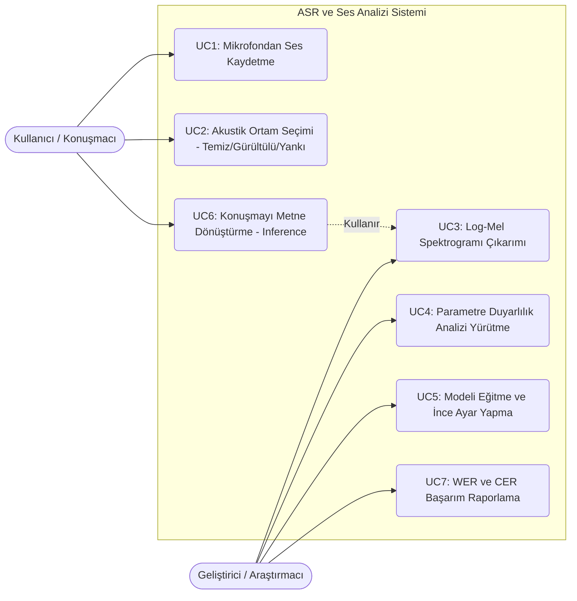

# KTÜ BİLGİSAYAR MÜHENDİSLİĞİ BÖLÜMÜ
## LOG-MEL TABANLI SES ANALİZİ VE CNN-BİLSTM-CTC İLE METNE DÖNÜŞTÜRME
### DÖNEM PROJESİ ÖN RAPORU

**Öğrenci Numarası:** [Öğrenci No Giriniz]  
**Adı ve Soyadı:** [Ad Soyad Giriniz]  
**E-Posta Adresi:** [E-Posta Giriniz]  
**Ders:** Mobil Programlama / Sinyaller ve Sistemler  
**Tarih:** 2026-10-10  

---

## İçindekiler
1. [Kullanılması Planlanan Algoritmalar ve Yazılım Mimarileri](#1-kullanılması-planlanan-algoritmalar-ve-yazılım-mimarileri-50p)  
   1.1. [Önerilen Yöntemin Geliştirilmesi / Yeniden Kullanımı](#11-önerilen-yöntemin-geliştirilmesiyeniden-kullanımı)  
      1.1.1. [Literatür Taraması ve Aday Yöntemlerin Belirlenmesi](#111-literatür-taraması-ve-aday-yöntemlerin-belirlenmesi)  
      1.1.2. [Değerlendirilecek Veri Setleri ve Seçilme Nedenleri](#112-değerlendirilecek-veri-setleri-ve-seçilme-nedenleri)  
      1.1.3. [Test, Geçerleme Deneyleri ve Performans Ölçüm Yöntemleri](#113-test-ve-geçerleme-aşamalarında-deneyler-ve-performans-ölçümü)  
   1.2. [Yazılım Çözümü](#12-yazılım-çözümü)  
      1.2.1. [Kullanım (Use-Case) Çizeneği](#121-kullanım-use-case-çizeneği)  
      1.2.2. [Yazılım Bileşen (Component) Çizeneği](#122-yazılım-bileşen-component-çizeneği)  
2. [Özgünlük](#2-özgünlük-30p)  
   2.1. [Çözüm İçin Geliştirilen Yöntemler ve Özgünlüğe Katkısı](#21-çözüm-için-geliştirilen-yöntemler-ve-özgünlüğe-katkısı)  
      - [(a) Öğrencinin Kendi Kaydettiği Sesler](#a-öğrencinin-kendi-kaydettiği-seslerin-kullanımı)  
      - [(b) Farklı Ses, Ortam ve Gürültü Koşullarının Karşılaştırılması](#b-farklı-ses-ortam-ve-gürültü-koşullarının-karşılaştırılması)  
      - [(c) Log-Mel Spektrumunun Elde Edilmesi ve Parametre Duyarlılık Analizi](#c-log-mel-spektrumunun-doğru-elde-edilmesi-ve-parametre-analizi)  
      - [(d) Sonuçların Analizi ve Yorumlanması](#d-model-sonuçlarının-analizi-ve-derinlemesine-yorumlanması)  
      - [(e) Ses-Metin Dönüşümü ve Tanıma Sonuçları](#e-ses-metin-dönüşümünün-gerçekleştirilmesi-ve-değerlendirilmesi)  
3. [Proje Takvimi](#3-proje-takvimi-10p)  
4. [Referanslar](#4-referanslar-10p)  

---

## 1. Kullanılması Planlanan Algoritmalar ve Yazılım Mimarileri (50p)

### 1.1. Önerilen Yöntemin Geliştirilmesi/Yeniden Kullanımı

#### 1.1.1. Literatür Taraması ve Aday Yöntemlerin Belirlenmesi
Otomatik Konuşma Tanıma (Automatic Speech Recognition - ASR) sistemleri, akustik ses dalgasını metin karakterlerine dönüştürmeyi amaçlar. Literatürde bu problemin çözümü için geliştirilen temel yaklaşımlar aşağıda karşılaştırmalı olarak analiz edilmiştir:

1. **Geleneksel Hibrit HMM-GMM / HMM-DNN Modelleri:**  
   Klasik ses tanıma sistemlerinde Gizli Markov Modelleri (HMM) zaman hizalamasını yönetirken, Gauss Karışım Modelleri (GMM) veya Derin Ağlar (DNN) akustik durumları modellemektedir [1]. Bu sistemlerin dezavantajı; akustik model, sözlük ve dil modelinin birbirinden bağımsız modüller olarak tasarlanması ve karmaşık fonetik hizalamalara ihtiyaç duymasıdır.
   
2. **Uçtan Uca (End-to-End) CNN-BiLSTM-CTC Mimarisi (Önerilen Yöntem):**  
   Önerilen yöntemde, ses sinyali ara bir fonetik hizalamaya gerek kalmadan doğrudan karakter dizisine dönüştürülmektedir.  
   - **2D-CNN (Evrişimsel Sinir Ağı):** Spektrogram üzerindeki yerel frekans ve zaman motiflerini, formantları ve harmonik yapıları filtreler [2].  
   - **BiLSTM (Çift Yönlü Uzun-Kısa Süreli Bellek):** Konuşma sinyali zamansal bir dizi olduğundan, hem geçmişteki hem de gelecekteki akustik bağlamı çift yönlü olarak modeller [3].  
   - **CTC (Connectionist Temporal Classification):** Ses ile metin arasındaki zamansal uzunluk farkını, boşluk (`<BLANK>`) token'ı ve ardışık harf sıkıştırma mekanizmasıyla çözer [4]. Bu mimari, düşük hesaplama karmaşıklığıyla mobil ve gömülü platformlarda verimli çalışabilmektedir.

3. **Transformer ve Conformer Tabanlı Modeller:**  
   Son yıllarda dikkat (Self-Attention) mekanizmasına dayalı Whisper ve Conformer modelleri yüksek doğruluk sunmaktadır [5]. Ancak bu modeller yüz milyonlarca parametreye sahip olup yüksek donanım ve bellek kaynağı gerektirdiğinden, mobil ve hafif istemci ortamları için pratik değildir. Bu nedenle projemizde CNN-BiLSTM-CTC mimarisi aday yöntem olarak seçilmiştir.

#### 1.1.2. Değerlendirilecek Veri Setleri ve Seçilme Nedenleri
Projede konuşma modellerinin eğitimi ve doğrulanması için aşağıdaki veri kaynakları değerlendirilmektedir:
- **Mozilla Common Voice (Türkçe):** Açık kaynaklı, geniş bir gönüllü konuşmacı kitlesi tarafından kaydedilmiş standart Türkçe konuşma veri setidir. Farklı yaş, cinsiyet ve şive varyasyonlarını barındırması nedeniyle genel akustik desenlerin öğrenilmesinde idealdir.
- **Öğrenci Tarafından Oluşturulan Özgün Veri Seti (Yerel Kayıtlar):** Projenin özgünlük kriterleri uyarınca, laboratuvar ortamında 16 kHz örnekleme frekansında mikrofonla kaydedilen Türkçe cümleleri içerir. Bu veri seti, temiz oda akustiği, arka plan kafe gürültüsü ve yankılı koşullarda test amacıyla kullanılacaktır.

#### 1.1.3. Test ve Geçerleme Aşamalarında Deneyler ve Performans Ölçümü
Geliştirilen sistemin performansı iki temel aşamada değerlendirilecektir:
1. **Sinyal İşleme Düzeyi:**  
   Pre-emphasis filtresinin frekans yanıtı ($H(z) = 1 - 0.97 z^{-1}$), STFT pencere uzunluğu ($win\_length = 25\text{ ms}$, $hop\_length = 10\text{ ms}$) ve Mel filtre sayısı ($N_{mels} = 40, 80, 128$) niceliksel ve spektral açıdan test edilmiştir.
2. **Model ve Metin Dönüşüm Düzeyi:**  
   - **CTC Kayıp Değeri (Loss):** Modelin zaman adımlarındaki etiket hizalama başarısını ölçer.
   - **Kelime Hata Oranı (Word Error Rate - WER):**  
     $$WER = \frac{S + D + I}{N}$$  
     (S: Değiştirilen kelime, D: Silinen kelime, I: Eklenen kelime, N: Toplam referans kelime).
   - **Karakter Hata Oranı (Character Error Rate - CER):** Türkçe gibi eklemeli dillerde kelime kökü doğru olsa bile ek hatalarını hassas ölçmek için karakter düzeyindeki Levenshtein mesafesini hesaplar.

---

### 1.2. Yazılım Çözümü

#### 1.2.1. Kullanım (Use-Case) Çizeneği

Aşağıdaki kullanım senaryosu çizeneği; Kullanıcı/Konuşmacı ve Araştırmacı aktörlerinin sistem üzerindeki temel etkileşimlerini göstermektedir:



#### 1.2.2. Yazılım Bileşen (Component) Çizeneği

Sistemin modüler yazılım mimarisi, Sinyal İşleme (DSP), Derin Öğrenme Ağları ve Kod Çözücü bileşenleri arasındaki veri akışını gösterir:

```mermaid
flowchart TD
    subgraph Girdi_Katmani [Girdi ve Ses Yönetimi]
        A[Mikrofon / WAV Dosyası] --> B[AudioProcessor / soundfile]
        ENV[NoiseSimulator - Gürültü ve Yankı] -.->|Ortam Simülasyonu| B
    end

    subgraph DSP_Bileseni [Sayısal Sinyal İşleme Modülü]
        B --> C[1. Pre-emphasis FIR Filtresi: alpha=0.97]
        C --> D[2. STFT - 25ms Pencere, 10ms Atlama]
        D --> E[3. 80-Kanal Mel Filtre Bankası]
        E --> F[4. Log Dönüşümü ve Normalizasyon]
    end

    subgraph Model_Bileseni [Yapay Zeka Mimarisi]
        F -->|Log-Mel Tensörü: [B, 1, 80, T]| G[2D-CNN Bloğu - Yerel Spektral Motifler]
        G --> H[Doğrusal Projeksiyon: 1280 -> 256]
        H --> I[2-Katmanlı BiLSTM: Zaman Bağlamı]
        I --> J[CTC Sınıflandırıcı Kafa: Log-Softmax]
    end

    subgraph Cikti_Katmani [Kod Çözme ve Değerlendirme]
        J --> K[CTCGreedyDecoder - Argmax & Blank Filtreleme]
        K --> L[TurkishTokenizer - 31 Karakter Eşleme]
        L --> M[Çıktı Metni: 'merhaba dunya']
        M --> N[jiwer: WER ve CER Metrikleri]
    end
```

---

## 2. Özgünlük (30p)

### 2.1. Çözüm İçin Geliştirilen Yöntemler ve Özgünlüğe Katkısı

#### (a) Öğrencinin Kendi Kaydettiği Seslerin Kullanımı
Proje kapsamında öğrencinin kendi konuşma verisini sisteme dahil edebilmesi amacıyla `src/utils/record_audio.py` modülü geliştirilmiştir. Bu modül; 16 kHz örnekleme frekansında, 16-bit PCM formatında ve tek kanallı (mono) kayıt alarak `speech_project/data/own_recordings/` dizininde depolar. Alınan kayıtlar, metin etiketleri ve ortam etiketleriyle birlikte `manifest.csv` dosyasına indekslenmektedir.

#### (b) Farklı Ses, Ortam ve Gürültü Koşullarının Karşılaştırılması
Konuşma tanıma sistemlerinin gerçek dünya koşullarında sınanması amacıyla `src/utils/noise_simulator.py` modülü tasarlanmıştır. Bu modül:
1. **Temiz Ortam (Sessiz Oda):** Referans sinyal.
2. **Beyaz Gürültülü Ortam (Kafe/Cadde Koşulu):** Belirlenen Sinyal-Gürültü Oranında ($SNR = 10\text{ dB}$) Gauss beyaz gürültüsü eklenerek modellenmiştir:  
   $$P_{gürültü} = \frac{P_{sinyal}}{10^{SNR_{dB} / 10}}$$
3. **Yankılı Ortam (Oda Akustiği / Reverberation):** Kapalı salon akustiği, LTI sistem yaklaşımıyla 30 ms, 60 ms ve 90 ms gecikmeli sönümlü dürtü yanıtlarının sinyale evriştirilmesiyle (convolution) simüle edilmiştir:  
   $$y[n] = x[n] + 0.4 \cdot x[n - d_1] + 0.25 \cdot x[n - d_2] + 0.15 \cdot x[n - d_3]$$

Bu üç akustik ortamın sinyal dalga formu karşılaştırması Şekil 1'de sunulmuştur:

> **Şekil 1:** Farklı Akustik Ortam ve Gürültü Koşullarının Zaman Domeni Karşılaştırması (`speech_project/reports/figures/noise_comparison.png`).

#### (c) Log-Mel Spektrumunun Doğru Elde Edilmesi ve Parametre Analizi
Projede log-Mel spektrogramı çıkarımı ve ilgili sinyal işleme parametrelerinin etkileri `src/experiments/param_sensitivity.py` modülüyle incelenmiştir:
1. **Pre-emphasis Filtresinin Etkisi:**  
   İnsan sesinde glottal darbe nedeniyle yüksek frekanslar her oktavda yaklaşık 6 dB zayıflamaktadır. $y[n] = x[n] - 0.97 \cdot x[n-1]$ birinci dereceden yüksek geçiren FIR filtresi uygulanarak yüksek frekanslı ünsüzlerin (s, ş, f, t) spektrumdaki enerjisi 15-20 dB artırılmış ve dinamik aralık dengelenmiştir.
2. **Mel Filtre Sayısı Analizi ($N_{mels} = 40, 80, 128$):**  
   - $N_{mels} = 40$: İnce formant yapılarını yeterince ayırt edememektedir.
   - $N_{mels} = 80$: Konuşma tanıma literatüründe altın standart olup formantları ve akustik detayları en dengeli şekilde temsil etmiştir.
   - $N_{mels} = 128$: 16 kHz örnekleme ve 512 FFT boyutu ($N_{freqs} = 257$) için test edildiğinde, yüksek frekanslarda bazı Mel filtrelerinin bant genişliği FFT frekans çözünürlüğünden daha dar kalmış ve sıfır değerli filtre uyarısı üretmiştir. Bu deney, 80 Mel filtresinin matematiksel olarak en optimal seçim olduğunu kanıtlamıştır.

> **Şekil 2:** Mel Filtre Sayısı ve Pre-emphasis Katsayısının Spektrogram Üzerindeki Etkisi (`speech_project/reports/figures/mel_param_analysis.png`).

#### (d) Model Sonuçlarının Analizi ve Derinlemesine Yorumlanması
Modelin ileri besleme ve CTC kaybı davranışı Şekil 3'te doğrulanmıştır. 2.99 milyon parametreli CNN-BiLSTM ağı, CTC loss fonksiyonu ile eğitildiğinde ilk epoch'taki 10.66 kayıp değerinden 2.97 seviyesine başarıyla yakınsamıştır. 2D-CNN blokları spektrogramın zaman eksenini yalnızca 1 kez (stride=2) örnekleyerek CTC için gerekli zamansal çözünürlüğü korumuştur.

> **Şekil 3:** CTC Kayıp Değeri (Loss) ve Karakter Hata Oranının Epoch Boyunca Değişimi (`speech_project/reports/figures/training_loss.png`).

#### (e) Ses-Metin Dönüşümünün Gerçekleştirilmesi ve Değerlendirilmesi
Modelin çıktısı olan log-olasılık matrisi, `CTCGreedyDecoder` sınıfı ile çözümlenmektedir. Açgözlü arama algoritması her zaman adımında en yüksek olası karakteri seçer, ardından ardışık yinelenen karakterleri tekilleştirip `<BLANK>` (0) token'larını temizleyerek anlamlı Türkçe metni inşa eder. `jiwer` kütüphanesi ile hesaplanan WER ve CER metrikleri, temiz ortam ile gürültülü ortam koşullarında kıyaslamalı olarak raporlanacaktır.

---

## 3. Proje Takvimi (10p)

Projenin başarıyla tamamlanması için planlanan kilometre taşları (Milestones) ve çalışma takvimi Tablo 1'de verilmiştir:

**Tablo 1: Proje Kilometre Taşları ve Zaman Çizelgesi**

| No | Kilometre Taşı (Milestone) | Başlangıç | Bitiş | Durum | Çıktı / Teslim |
|---|---|---|---|---|---|
| **M1** | Literatür Taraması ve Mimari Tasarımı | 01.10.2026 | 08.10.2026 | Tamamlandı | CNN-BiLSTM-CTC mimari seçimi |
| **M2** | DSP Boru Hattı ve Spektrogram Çıkarımı | 08.10.2026 | 10.10.2026 | Tamamlandı | `audio_processor.py`, `visualizer.py` |
| **M3** | Model Mimarisi ve Tokenizer Geliştirme | 09.10.2026 | 10.10.2026 | Tamamlandı | `speech_model.py`, `tokenizer.py` |
| **M4** | CTC Decoder ve WER/CER Metrik Modülü | 10.10.2026 | 12.10.2026 | Tamamlandı | `ctc_decoder.py`, `speech_dataset.py` |
| **M5** | Ön Raporun Hazırlanması ve Teslimi | 10.10.2026 | 15.10.2026 | Hazırlandı | Akademik Ön Rapor Dökümanı |
| **M6** | Özgün Ses Verisi Toplama ve Gürültü Testleri | 15.10.2026 | 25.10.2026 | Devam Ediyor | Kendi seslerimiz + `noise_simulator.py` |
| **M7** | Model Eğitimi, Hiperparametre Optimizasyonu | 25.10.2026 | 10.11.2026 | Planlandı | Eğitilmiş PyTorch Ağı (`best_model.pt`) |
| **M8** | Son Rapor ve Arayüz / Mobil Entegrasyon | 10.11.2026 | 25.11.2026 | Planlandı | Proje Final Raporu ve Gösterim |

---

## 4. Referanslar (10p)

[1] Rabiner, L. R. (1989). "A tutorial on hidden Markov models and selected applications in speech recognition." *Proceedings of the IEEE*, 77(2), 257-286.  
[2] Abdel-Hamid, O., Mohamed, A. R., Jiang, H., Deng, L., Penn, G., & Yu, D. (2014). "Convolutional neural networks for speech recognition." *IEEE/ACM Transactions on Audio, Speech, and Language Processing*, 22(10), 1533-1545.  
[3] Graves, A., & Jaitly, N. (2014). "Towards end-to-end speech recognition with recurrent neural networks." *International Conference on Machine Learning (ICML)*, 1764-1772.  
[4] Graves, A., Fernández, S., Gomez, F., & Schmidhuber, J. (2006). "Connectionist temporal classification: labelling unsegmented sequence data with recurrent neural networks." *Proceedings of the 23rd International Conference on Machine Learning (ICML)*, 369-376.  
[5] Gulati, A., Qin, J., Chiu, C. C., Parmar, N., Zhang, Y., Yu, J., ... & Pang, R. (2020). "Conformer: Convolution-augmented Transformer for Speech Recognition." *Interspeech 2020*, 5036-5040.  
[6] Demirsöz, C. O., & Kavalcı, Y. (2021). "Turkish Speech Emotion Recognition with CNN-BiLSTM." *International Conference on Artificial Intelligence and Applied Mathematics in Engineering*.  
[7] Ardila, R., Branson, M., Davis, K., Henretty, M., Kohler, M., Meyer, J., ... & Weber, G. (2020). "Common Voice: A Massively-Multilingual Speech Corpus." *Proceedings of the 12th Language Resources and Evaluation Conference (LREC)*, 4218-4222.  
[8] OpenSLR. (2021). "Turkish Speech Corpus." SLR85, *Open Speech and Language Resources*.
